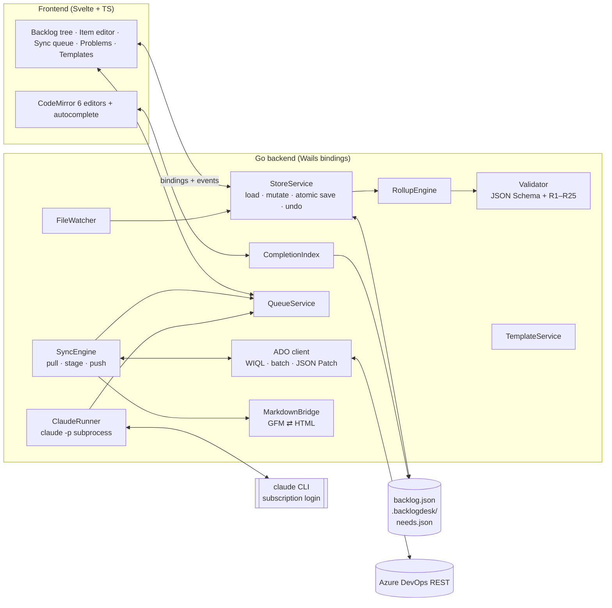
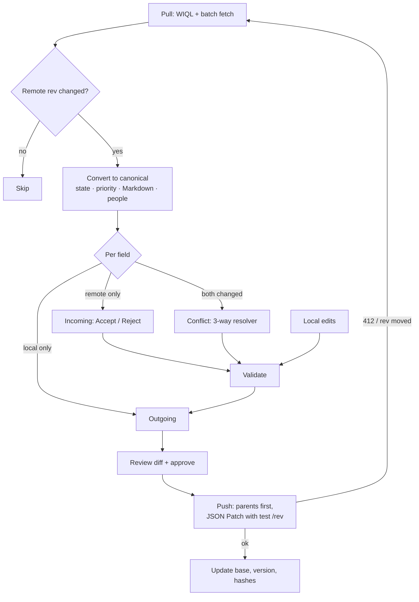

# Backlog Desk: UI & Design Spec

**Status:** draft v0.1 · **Date:** 2026-10-25 · **Based on:** `backlog-schema-design.md` (schema v2.0.0)

Backlog Desk is a single-user Wails desktop app (Go backend, web frontend) that edits `backlog.json`, validates it after every change, and syncs with Azure DevOps through a queue where every outgoing and incoming change is shown as a diff and approved first. Claude helps through `claude -p` subprocesses on the user's existing subscription. Claude only *proposes* changes; proposals go through the same review UI as everything else.

---

## 1. Overview

### 1.1 Goals

- Edit any field of any item, with type-aware forms driven by `model.types` (estimation and priority rules, states).
- Validate continuously: JSON Schema plus semantic rules R1–R25, with inline errors and quick fixes.
- Sync two-way with ADO via a review queue: field-level diffs, per-item approval, 3-way conflict resolution.
- Create Epics, Program Objectives, Features, Stories, Problems and Bugs locally and push them to ADO parents-first.
- Fast typing: local autocomplete for need ids, items, people, iterations, tags, states and link types.
- Templates per type that scaffold Markdown sections, default values and child items, and flag missing sections.

### 1.2 Non-goals (v1)

- Multi-user or server deployment. One person, one store file, one machine.
- Jira and GitHub mirrors. The UI is built on the tool-neutral model so they can be added later, but v1 ships ADO only.
- Anthropic API keys. Claude is reached only through the logged-in `claude` CLI.

### 1.3 Schema additions (v2.1.0)

| Change | Why | Detail |
|---|---|---|
| `bug` type in `model.types` | Requirement lists Bugs next to Problems | `level: workItem`, `estimation: optional`, `priority: required`; ADO `remoteType: "Bug"` |
| `model.templates` | Template-driven editing (§4) | Keyed by template id; each names its `type` |
| `schemaVersion` → `"2.1.0"` | Both additions are breaking under `additionalProperties: false` | Validator accepts 2.0.0 read-only and offers a one-click upgrade |

App state that isn't backlog content (sync queue, staged pulls, Claude session ids, UI settings) lives in a sidecar folder `.backlogdesk/` next to the store, never in `backlog.json`. This keeps principle 8 (sync state separate from content) intact.

### 1.4 Auth

- **Claude:** the `claude` CLI's existing login. The app strips `ANTHROPIC_API_KEY` from the child process environment so the CLI uses the subscription login rather than an API key.
- **ADO:** still needs its own credentials. Default: reuse the Azure CLI login (`az account get-access-token` for the Azure DevOps resource). Fallback: a Personal Access Token stored in the OS keychain (`zalando/go-keyring`), scope *Work Items (Read & Write)*.

---

## 2. Architecture

The Go backend owns all state and every write to disk or ADO. The frontend is a view with forms; it never touches files, ADO or `claude` directly.



### 2.1 Services

| Service | Responsibility | Key libraries |
|---|---|---|
| StoreService | Holds the store in memory; applies mutations as JSON Patch ops; undo/redo stack; atomic save (temp file + rename); keeps `last-valid.json` snapshot for R24/R25 | `encoding/json`, `evanphx/json-patch` |
| Validator | JSON Schema 2020-12 + semantic rules; returns `[]Issue{rule, level, itemId, field, message, fix?}` | `santhosh-tekuri/jsonschema/v6` |
| RollupEngine | Recomputes `rollup` on every mutation (§6 of schema doc); rollups are never edited | — |
| CompletionIndex | In-memory index of needs, items, people, iterations, tags, area paths; fuzzy match | `sahilm/fuzzy` |
| TemplateService | Applies templates to new items; lints items against their template | — |
| SyncEngine | Pull → stage incoming changes; compute outgoing changes from `current ≠ base`; execute approved pushes | — |
| QueueService | Persists review state of queue entries in `.backlogdesk/queue.json` | — |
| ADO client | WIQL query, `workitemsbatch`, create/update with JSON Patch (`test /rev` first), classification nodes, iterations, identities | `net/http` (REST 7.1) |
| MarkdownBridge | GFM → HTML on push, HTML → GFM on pull, rich-text hashes | `yuin/goldmark`, `JohannesKaufmann/html-to-markdown` |
| ClaudeRunner | Runs `claude -p`, parses JSON, validates proposals, manages sessions, timeouts, cancellation | `os/exec`, `context` |
| FileWatcher | Detects external edits (e.g. a Claude Code agent editing the file in a terminal) and offers reload/merge | `fsnotify/fsnotify` |

### 2.2 Files on disk

```text
my-backlog/
├── backlog.json              # the store (only content + remotes, per schema)
├── backlog.schema.json
├── needs.json                # Sphinx-Needs export (path configurable)
└── .backlogdesk/
    ├── settings.json         # needs.json path, auto-pull interval, UI prefs
    ├── queue.json            # review state of outgoing entries
    ├── incoming.json         # staged pulled changes awaiting acceptance
    ├── last-valid.json       # previous valid store, for R24/R25
    ├── claude-sessions.json  # itemId -> session_id
    └── log/                  # sync + claude run logs (JSONL)
```

### 2.3 Data flow of one edit

1. Frontend calls `Store.Apply(ops)` with JSON Patch ops (e.g. `replace /items/ado-301/storyPoints`).
2. StoreService applies ops to a copy → RollupEngine recomputes → Validator runs (~ms for a few thousand items).
3. The new state is kept in memory either way. If there are no E-level issues, it's saved to disk. If there are, the UI shows a "Unsaved – 2 errors" badge and saving/pushing is blocked until they're fixed.
4. Backend emits `store:changed` (with changed item ids) and `validation:changed`; the queue recomputes outgoing diffs for those items.

---

## 3. Screens and layout

### 3.1 Main window

```text
┌────┬──────────────────────────────────────────────────────────┬───────────────────────────┐
│ ☰  │ Payments ▸ Checkout     🔍 Ctrl+K     ● Saved   ⟳ ADO 2m ago │                           │
├────┼──────────────────────────────────────────────────────────┤  INSPECTOR                 │
│ ▤  │ Filter: [Sprint 1 ▾] [Type ▾] [State ▾] [Mine]   + New ▾   │  ★ Feature  ado-300  ↗ADO  │
│Back│ ┌────────────────────────────────────────────────────────┐ │  One-click card payment    │
│log │ │ ⋮ ▸ ◆ ado-100 Self-service checkout   Active   Σ8      │ │  State [Active ▾] Prio [–] │
│    │ │ ⋮   ▸ ◎ ado-200 Cut drop-off by 15%   Active   Σ8      │ │  Effort Σ 8 (2 est, 1 n/e) │
│ ⇅  │ │ ⋮     ▾ ★ ado-300 One-click card pay. Active   Σ8  ●   │ │  ── Description ──────────  │
│Sync│ │ ⋮         ⚠ ado-303 3DS timeout mobile Active P1 –     │ │  Let returning customers…  │
│ (3)│ │ ⋮         ▪ ado-301 Store tokenized    Active P2 5  ✎  │ │  ── Links ────────────────  │
│ ⚠  │ │ ⋮         ▪ ado-302 Pay with stored    New    P2 3     │ │  delivers  feat__stored_…  │
│Prob│ │ ⋮         ▪ new-refund-flow Refund…    Removed     8   │ │  implements feat_req__one… │
│ (1)│ └────────────────────────────────────────────────────────┘ │      v3 ⚠ suspect (now v4) │
│ ▦  │                                                            │  ── Claude ───────────────  │
│Plan│                                                            │  [Draft AC] [Split] [Ask…] │
├────┴──────────────────────────────────────────────────────────┴───────────────────────────┤
│ ✓ valid · 1 warning   │ Outgoing 2 · Incoming 1 · Conflicts 0   │ claude: idle               │
└──────────────────────────────────────────────────────────────────────────────────────────┘
```

Left rail: **Backlog**, **Sync** (badge = entries needing review), **Problems** (badge = errors + warnings), **Plan** (iterations), **Trace** (traceability), **Templates**, **Settings**. Right inspector can be popped out into a full editor tab (double-click a row or `Enter`).

### 3.2 Backlog tree

A tree-table of the whole hierarchy, ordered by `rank` within siblings.

| Column | Content | Editable inline |
|---|---|---|
| Drag handle | Rerank / reparent | Drag |
| Type icon | ADO-style color per type | — |
| Id | `ado-301`, `new-refund-flow` (monospace) | — |
| Title | | Yes |
| State | Chip colored by state category | Dropdown (states of this type only) |
| Priority | P1–P4 | Dropdown |
| SP / Σ | Story points for work items; `Σ rollup` for higher levels, grey with `+n unest.` hint | Work items only, if type allows |
| Iteration | | Autocomplete |
| Assigned | Avatar initials | Autocomplete (`people`) |
| Sync | ● modified · ✚ new · ⇣ incoming · ⚡ conflict · ✓ in sync | — |
| Valid | ⛔ error / ⚠ warning, tooltip with rule | — |

Behaviour:

- **Drag to rerank:** sets `rank` to the midpoint between neighbours (renumbers siblings if gaps get below 1e-6; avoids R21).
- **Drag to reparent:** only rows of the level exactly one above light up as drop targets (R4).
- **Multi-select bulk edit:** state, iteration, priority, tags, assignee.
- **Removed items:** shown struck-through and muted, hidden by a "Show removed" toggle.
- **Delete:** for items with any `remotes` entry the action is labeled *Remove* and sets the Removed-category state (R24). Unsynced `new-*` items can be truly deleted (with confirmation).

### 3.3 Item editor

Sections, top to bottom:

1. **Header:** type icon + label, id, ADO link (↗), sync badge, template name, `⋯` menu (duplicate, change type, apply template, history).
2. **Fields grid:** generated from `model.types[type]`:
   - `storyPoints` hidden when `estimation: forbidden`; for non-leaf types shows read-only rollup instead.
   - Required fields (`priority: required`, `estimation: required`) get a required marker and inline error.
   - `state` dropdown lists only that type's states, colored by category.
   - Fields not mapped to ADO (`mappings.ado.fields`) carry a small "local only" tag, so the user knows they won't sync.
3. **Description / Acceptance criteria:** CodeMirror Markdown editors with tabs *Write · Preview · As ADO sees it* (rendered HTML via MarkdownBridge). Template sections appear as guided headings (§4).
4. **Links:** grouped by link type. The "+ Link" picker offers only link types whose `fromLevels` include this item's level, then only targets matching `targetKind` / `targetTypes`. Need links show title, status and pinned version; suspect links show `⚠ v3 → v4` with a **Review** button that opens a side-by-side of the two requirement versions (from `needs.json` history if available, else current text + pinned hash) and an **Accept new version** action that updates the pin and asks for a note.
5. **Children:** list of children with mini rollup bar (estimated / unestimated / not estimable). "+ Add child" pre-selects valid child types.
6. **Local notes:** plain Markdown, labeled "never synced".
7. **Claude panel:** actions (§7) plus a per-item conversation that resumes the same session.
8. **Sync info:** read-only `remotes.ado` (rev, changedBy, changedAt, lastSyncedAt) and a "diff vs last sync" toggle that highlights fields changed since `base`.

### 3.4 Other screens

| Screen | Purpose |
|---|---|
| Sync queue | Outgoing / Incoming / Conflicts review with diffs (§6) |
| Problems | All validation issues, filter by rule/level, click to jump, quick fixes (§5) |
| Plan | Iterations as columns, work items as cards, SP total per iteration; drag between iterations; iteration dates editable (R12) |
| Trace | Need → items matrix from `needs.json`: which `feat_req`/`comp_req` have no implementing item, suspect links, links to `invalid` needs |
| Templates | Create/edit templates (§4) with live preview of a new item |
| Settings | Store path, needs.json path, ADO connection (from `mappings.ado.connection`), auth method + test button, auto-pull interval, `claude` path + "Check login", theme |

---

## 4. Editing, templates and autocomplete

### 4.1 Creating items

`+ New` (or `N` in the tree) opens a small dialog: **type** → **template** (filtered by type, default preselected) → **title** → **parent** (autocomplete, only valid parent levels). The key is generated as `new-<slug>` from the title, deduplicated (`new-refund-flow-2`), and shown before creation so the user can change it. After creation it never changes.

### 4.2 Templates

Templates live in `model.templates` (schema 2.1.0):

```json
"templates": {
  "story-default": {
    "type": "story",
    "label": "User story",
    "default": true,
    "fields": { "state": "New", "priority": 3, "tags": [] },
    "description": "## As a\n\n## I want\n\n## So that\n",
    "acceptanceCriteria": "- [ ] \n",
    "requiredSections": { "description": ["As a", "I want", "So that"] },
    "requiredLinks": ["implements"],
    "children": []
  },
  "feature-default": {
    "type": "feature",
    "label": "Feature",
    "description": "## Outcome\n\n## Scope\n\n## Out of scope\n\n## Risks\n",
    "requiredSections": { "description": ["Outcome", "Scope"] },
    "requiredLinks": ["delivers"],
    "children": [
      { "type": "story", "template": "story-default", "title": "Spike: {{parent.title}}" }
    ]
  },
  "bug-default": {
    "type": "bug",
    "label": "Bug",
    "fields": { "priority": 2 },
    "description": "## Steps to reproduce\n\n## Expected\n\n## Actual\n\n## Environment\n",
    "requiredSections": { "description": ["Steps to reproduce", "Expected", "Actual"] }
  }
}
```

Template behaviour:

- **Apply on create:** fields, Markdown skeletons and child items are filled in.
- **Apply later:** "Apply template" merges missing sections into existing text and never overwrites content.
- **Template lint** (warnings, prefix `T`, separate from schema rules):
  - T1 required section heading missing or empty.
  - T2 required link type missing.
  - T3 unchecked placeholder left (`- [ ] ` empty).
- **Guided editing:** in the Markdown editor, required sections show as a checklist above the editor; clicking one jumps to (or inserts) its heading.
- The template id used is remembered in `.backlogdesk/` per item (not in the store), so lint knows which template applies.

### 4.3 Autocomplete

Autocomplete is local and instant (Go `CompletionIndex`, < 20 ms). Claude is too slow (seconds) for keystroke completion, so AI help is an explicit action, not ghost text.

| Where | Trigger | Source | Shown in list |
|---|---|---|---|
| Parent field | typing | items of the valid parent level | id, type icon, title, state |
| Link target (need) | typing in link picker, filtered by link type | `needs.json`, filtered by `targetTypes` | need id, title, status, version; `invalid` greyed |
| Link target (item) | typing | items | id, title |
| Iteration | typing | `iterations` | name, dates, "current" badge |
| Assigned to | typing | `people` | display name, email |
| Tags / components | typing, `;` or `,` to commit | existing values across the store | value, usage count |
| Area | typing | ADO classification nodes (cached on pull) | path |
| State | dropdown | `model.types[type].states` | name, category color |
| Markdown editors | `#` | items | inserts `#ado-301` (rendered as a link) |
| Markdown editors | `@` | people | inserts display name |
| Markdown editors | `[[` | needs | inserts `[[feat_req__one_click_pay]]` and offers "also add as `implements` link?" |
| Command palette `Ctrl+K` | typing | items, screens, actions | fuzzy |

Need links picked through autocomplete pin the current `version`/`hash` from `needs.json` automatically for link types with `pinVersion: true`.

---

## 5. Validation

- Runs in Go after **every** mutation (debounced ~150 ms while typing), and after pull, template apply and Claude proposal apply.
- **Schema errors** come from JSON Schema (path mapped to item + field). **Semantic rules** R1–R25 run after. **Template lint** T1–T3 runs last (warnings only).
- If `needs.json` is missing or stale, R18–R20 are skipped and the status bar says so ("needs.json not found – trace checks skipped").

### 5.1 Where issues appear

| Place | What |
|---|---|
| Field | Red/amber underline + message under the field |
| Tree row | ⛔ / ⚠ badge with tooltip |
| Problems screen | Full list: level, rule, item, field, message, quick fix |
| Status bar | `✓ valid · 1 warning` or `⛔ 2 errors – not saved` |

### 5.2 Gates

| Action | Blocked by |
|---|---|
| Save to disk | Any E-level issue (in-memory edits are kept, so nothing is lost) |
| Push to ADO | Any E-level issue anywhere; R23 conflicts block push of that item only |
| Accept incoming | Never blocked; issues the incoming change introduces are shown in the diff before accepting |

### 5.3 Quick fixes

| Rule | Quick fix |
|---|---|
| R4 wrong parent level | Open parent picker filtered to valid level |
| R5 orphan | Pick parent |
| R7 points on forbidden type | Clear story points |
| R8 missing estimate | Focus story points field |
| R9 missing priority | Focus priority field |
| R10 rollup mismatch | (Never surfaces in practice: rollups recompute automatically) |
| R19 suspect link | Open requirement diff → accept new version + note |
| R21 duplicate rank | Renumber siblings |
| R22 raw HTML in Markdown | Convert HTML to Markdown |
| R23 conflict | Open conflict resolver |
| R24 synced item deleted | Undo delete, set Removed instead |

R24/R25 are also prevented in the UI: there's no delete for synced items, and `remotes` / `rollup` are read-only everywhere.

---

## 6. Sync queue and approval

Nothing moves between the store and ADO without the user seeing the diff. The queue has three tabs.

### 6.1 Outgoing (store → ADO)

Derived, not stored: for each item, compare current fields to `remotes.ado.base` (only fields mapped in `mappings.ado.fields` plus core fields). The queue file only stores review status.

Entry kinds:

- **Create:** item without `remotes.ado`. Shows the full item as it will appear in ADO (type mapping, rendered HTML, parent). Children of a not-yet-created parent are marked "waits for parent"; approving a child auto-includes its parent.
- **Update:** field-level diff `base → local`. Markdown fields show a line diff of the Markdown and, on a toggle, the rendered ADO HTML.
- **Links:** added/removed relations and hyperlinks (need links rendered via `urlTemplate`).

Each entry has field checkboxes (send only some fields; unchecked fields stay outgoing for later), **Approve**, **Skip**, and **Show raw request** (the exact JSON Patch body, including `test /rev`).

**Push run:** user clicks *Push approved (n)* → creates go parents-first, then updates → per-entry status `Approved → Sending → Done | Failed | Stale`. *Stale* means ADO's rev moved; that item is re-pulled automatically and appears under Incoming or Conflicts. On success, `version`, `base`, `richTextHashes`, `lastSyncedAt` are updated by the sync engine only.

### 6.2 Incoming (ADO → store)

**Pull** (manual, or every N minutes; default 10) fetches by `sync.scope.ado` WIQL. Remote changes are **staged** in `.backlogdesk/incoming.json`, not applied. For each changed item:

- **Remote-only changes:** diff `local → remote`, Accept / Reject per field.
  - *Accept:* field takes remote value, base for that field updated.
  - *Reject:* base is updated to the remote value but local stays, so the local value shows up as an outgoing change (it will overwrite ADO when pushed).
- **New remote items:** shown with their place in the tree; Accept creates `ado-<id>`.
- **Remote removals / moved out of scope:** shown as a warning; accept sets the Removed state locally.
- Option (off by default): "Auto-accept remote-only changes to fields I haven't touched".

### 6.3 Conflicts

When both sides changed a field to different values, the resolver shows three columns:

| Base (last sync) | Mine (local) | Theirs (ADO, rev 8, by Anna, 10:42) |
|---|---|---|

Actions per field: **Keep mine**, **Take theirs**, **Edit merged** (Markdown fields open a 3-way merge editor), **Ask Claude** (proposes a merged text with an explanation; still needs approval). Resolving writes the chosen value and removes the conflict entry (as the schema's agent rules require).

### 6.4 Sync flow



### 6.5 ADO specifics

- Work item types from `mappings.ado.types` (Epic, Program Objective, Feature, User Story, Problem, Bug). On first connect, the app reads the process's work item types and warns if a mapped type doesn't exist in the ADO project.
- Story points field depends on process (Agile `StoryPoints`, Scrum `Effort`); read from `mappings.ado.fields`.
- Rank: `StackRank` (Agile) / `BacklogPriority` (Scrum). Local fractional ranks are converted to spaced integers on push.
- Feature effort pushed to `rollupEffort` field only if mapped.
- Iterations and area paths cached on each pull; iteration create/edit is pushed through the classification nodes API.
- Rate limiting: respect `Retry-After`; batch reads of 200 ids.

---

## 7. Claude integration

### 7.1 How it's called

```bash
claude -p "<prompt>" \
  --output-format json \
  --allowedTools "Read,Grep,Glob" \
  --append-system-prompt "<app rules>" \
  [--resume <session_id>]
```

- Working directory: the store folder, so Claude can read `backlog.json`, `needs.json` and docs, but the allowed tools are **read-only**. Claude never writes the store; it returns a proposal.
- Environment: `ANTHROPIC_API_KEY` removed so the subscription login is used.
- Each run has a timeout (default 120 s) and a Cancel button (kills the process via `context`).
- Max 2 concurrent runs; others queue. Status bar shows `claude: running "Draft AC" 14s`.
- On startup, Settings → "Check Claude" runs a tiny prompt and reports whether the CLI is found and logged in.
- Every run is logged to `.backlogdesk/log/claude.jsonl` (prompt, duration, num_turns, result) for traceability.

### 7.2 Output contract

The app asks for one JSON object in `result` and validates it before showing anything:

```json
{
  "summary": "Drafted acceptance criteria from feat_req__one_click_pay v3.",
  "proposal": [
    { "op": "replace", "path": "/items/ado-302/acceptanceCriteria", "value": "- Card is charged…" },
    { "op": "add", "path": "/items/new-pay-retry", "value": { "id": "new-pay-retry", "type": "story", "...": "..." } }
  ],
  "questions": ["Should retries apply to 3DS challenges too?"]
}
```

- `proposal` is a JSON Patch limited to `/items/*` and never to `remotes` or `rollup` (rejected otherwise).
- The patch is applied to a copy and validated. Invalid proposals are shown with their errors and a "Ask Claude to fix" button that resumes the session with the validation output.
- Valid proposals open in the same diff view as the sync queue, labeled **Claude proposal**, with per-field accept.
- If JSON parsing fails, retry once with "Return only the JSON object"; then show the raw text.

### 7.3 Actions

| Action | Where | Context sent | Returns |
|---|---|---|---|
| Draft description / AC | Item editor | Item, template sections, linked needs' text | Patch on description / AC |
| Split into work items | Feature editor | Feature, linked `feat_req`s, template | New child items (patch) |
| Suggest links | Item editor | Item text; Claude greps `needs.json` | `implements` / `verifiedBy` links with pinned versions |
| Review suspect link | Link panel | Old vs new requirement text, item | Summary of impact + suggested edits |
| Resolve conflict | Conflict resolver | Base, mine, theirs | Merged value + rationale |
| Backlog health check | Problems screen | Whole store (read via tool) | List of findings (no patch) |
| Ask… (free text) | Command palette / item chat | Selected items | Answer and optional patch, e.g. "move all P1 Problems into Sprint 2" |

Per-item chat keeps a `session_id` in `.backlogdesk/claude-sessions.json` and resumes it with `--resume`, so follow-ups ("make it shorter") have context.

### 7.4 App rules (appended system prompt, abridged)

- You are helping a Product Owner edit a backlog store. Never edit files.
- Return only the JSON object described. Use Markdown, never HTML.
- New items get `new-<slug>` ids. Never touch `remotes` or `rollup`. Never delete synced items; use a Removed state.
- When linking a requirement, pin its current `version` or `hash` from `needs.json`.
- Backlog *Feature* (delivery unit) ≠ S-CORE `feat` (architecture feature).

---

## 8. Visual design

### 8.1 Principles

Dense, keyboard-first, calm. Looks like a professional tool next to ADO and VS Code: compact rows, neutral surfaces, color reserved for meaning (type, state category, sync status, errors).

### 8.2 Tokens

| Token | Light | Dark | Use |
|---|---|---|---|
| `--bg` | `#FAFAF9` | `#18181B` | App background |
| `--surface` | `#FFFFFF` | `#202024` | Panels, editor |
| `--border` | `#E4E4E7` | `#33333A` | Dividers |
| `--text` | `#18181B` | `#F4F4F5` | Primary text |
| `--text-muted` | `#71717A` | `#A1A1AA` | Secondary text, Removed items |
| `--accent` | `#2563EB` | `#60A5FA` | Focus, primary buttons, links |
| `--ok` | `#16A34A` | `#4ADE80` | Valid, synced |
| `--warn` | `#D97706` | `#FBBF24` | Warnings, suspect links |
| `--err` | `#DC2626` | `#F87171` | Errors, conflicts |
| `--diff-add` | `#DCFCE7` | `#14532D` | Diff added |
| `--diff-del` | `#FEE2E2` | `#7F1D1D` | Diff removed |

Type colors follow ADO so items are recognisable: Epic `#FF7B00`, Feature `#773B93`, User Story `#009CCC`, Bug `#CC293D`; Program Objective and Problem use the colors configured in the ADO process (read on connect, fallback `#5C6BC0` / `#E06C00`).

State category chips: Proposed = grey outline, InProgress = blue, Resolved = teal, Completed = green, Removed = muted + strikethrough on title.

### 8.3 Typography and density

- UI: Inter 13 px, line height 1.45; headings 15/600.
- Ids, JSON, need ids: JetBrains Mono 12 px.
- Tree rows 28 px (compact) or 34 px (comfortable) toggle.
- Spacing scale 4 / 8 / 12 / 16 / 24.

### 8.4 Components

Tree-table (virtualized, e.g. TanStack Virtual), chip, dropdown with category colors, CodeMirror editor, diff view (side-by-side + inline toggle, jsdiff), 3-way merge (CodeMirror merge), toast for save/push results, command palette, inline validation message, badge counters on rail.

### 8.5 Keyboard shortcuts

| Keys | Action |
|---|---|
| `Ctrl+K` | Command palette |
| `N` | New item (child of selection if valid) |
| `Enter` / `Esc` | Open editor / close |
| `↑ ↓ ← →` | Move / collapse / expand in tree |
| `Alt+↑ / Alt+↓` | Move item up/down in rank |
| `Tab / Shift+Tab` | Indent/outdent (reparent) where level rules allow |
| `Ctrl+S` | Save (if valid) |
| `Ctrl+Z / Ctrl+Shift+Z` | Undo / redo |
| `Ctrl+Shift+P` | Pull from ADO |
| `Ctrl+Shift+U` | Open sync queue |
| `A` / `R` (in queue) | Approve / reject focused entry |
| `Ctrl+J` | Claude on selection |
| `F8` | Next problem |

---

## 9. Go ↔ frontend API (Wails bindings and events)

```go
// StoreService
func (s *Store) Open(path string) (Snapshot, error)
func (s *Store) Get() Snapshot                              // items, model, people, iterations (no remotes.base)
func (s *Store) Apply(ops []PatchOp, label string) (ApplyResult, error) // returns issues
func (s *Store) CreateItem(req CreateItemRequest) (string, error)       // type, template, title, parent
func (s *Store) RemoveItem(id string) error                             // Removed state or real delete for new-*
func (s *Store) Move(id, newParent string, beforeId string) error       // rank + parent
func (s *Store) Undo() error
func (s *Store) Redo() error
func (s *Store) Save() error

// Validation
func (v *Validator) Issues() []Issue
func (v *Validator) QuickFix(issueId string) error

// Autocomplete
func (c *Completion) Suggest(kind string, query string, ctx CompletionCtx) []Suggestion

// Templates
func (t *Templates) List(itemType string) []Template
func (t *Templates) Apply(itemId, templateId string) ([]PatchOp, error) // preview, then Store.Apply
func (t *Templates) Save(tpl Template) error

// Sync
func (s *Sync) Pull() (PullSummary, error)
func (s *Sync) Outgoing() []QueueEntry
func (s *Sync) Incoming() []QueueEntry
func (s *Sync) Conflicts() []Conflict
func (s *Sync) Approve(entryId string, fields []string) error
func (s *Sync) RejectIncoming(entryId string, fields []string) error
func (s *Sync) Resolve(itemId, field string, choice Resolution) error
func (s *Sync) Push() (PushSummary, error)
func (s *Sync) RawRequest(entryId string) (string, error)

// Claude
func (c *Claude) Run(action string, itemIds []string, userText string) (RunId, error)
func (c *Claude) Cancel(run RunId) error
func (c *Claude) Check() (ClaudeStatus, error)

// Settings
func (s *Settings) Get() Settings
func (s *Settings) Update(Settings) error
func (s *Settings) TestAdo() (AdoStatus, error)
```

Events (backend → frontend):

| Event | Payload |
|---|---|
| `store:changed` | changed item ids, dirty flag |
| `store:external-change` | file changed on disk; offer reload/merge |
| `validation:changed` | counts + changed issues |
| `sync:progress` | phase, done/total, current item |
| `sync:entry` | entry id, status |
| `claude:status` | run id, state, elapsed |
| `claude:result` | run id, summary, proposal id or error |

---

## 10. Milestones

| # | Milestone | Done when |
|---|---|---|
| M1 | Viewer + validation | Opens store, tree + inspector read-only, Problems screen with all rules |
| M2 | Editing | Inline + editor edits, create/remove/move, undo, rollups, atomic save, autocomplete |
| M3 | Templates | `model.templates`, create with template, template lint, Templates screen |
| M4 | Pull + incoming review | ADO auth, WIQL pull, staged incoming diffs, accept/reject, conflict resolver |
| M5 | Push queue | Outgoing diffs, approve, parents-first creates, `test /rev`, stale handling |
| M6 | Claude | Runner, output contract, proposals in diff view, the 7 actions, per-item sessions |
| M7 | Plan + Trace | Iteration board, traceability matrix, suspect-link review |

## 11. Open questions

- Does the ADO process already have **Program Objective** and **Problem** types, and is it Agile or Scrum (story points vs effort, StackRank vs BacklogPriority)?
- Does the ADO organization have Markdown support for large text fields? If yes, set `richText: "markdown"` and skip HTML conversion.
- ADO auth: is the Azure CLI available on the PO's machine, or PAT only?
- Will other agents (e.g. Claude Code in a terminal) edit `backlog.json` while the app is open? If yes, M2 needs the external-change merge, not just reload.
- Should templates be shared across projects (a separate file) instead of living in `model.templates`?
- Is `needs.json` produced locally, or downloaded from a CI docs build? (Affects freshness checks for R18–R20.)
- Should accepted Claude proposals be marked (e.g. a tag or `localNotes` line) for audit?
